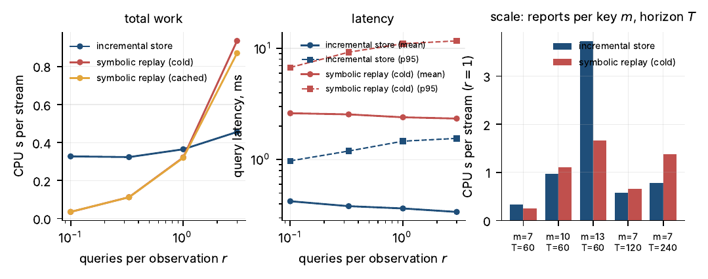
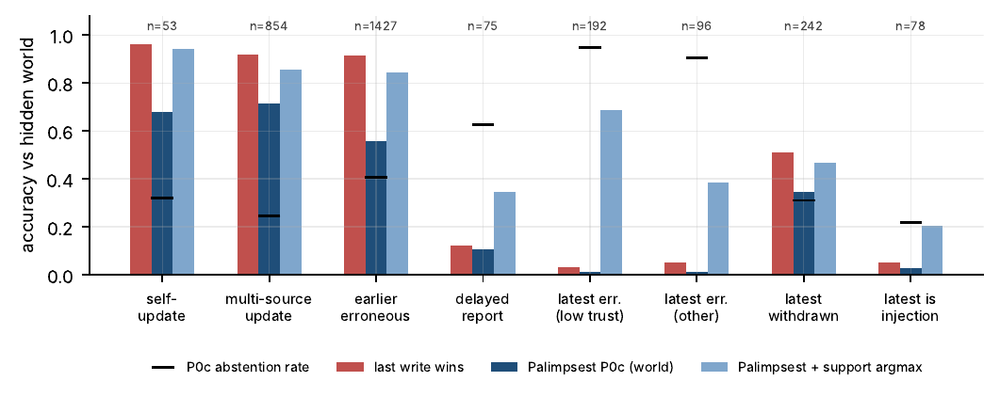

# PALIMPSEST

**Evaluating retraction and uncertainty in LLM memory: a semantics of justified belief, a benchmark where the world, the reports and what the reports justify are kept apart, and an incremental store that propagates evidence withdrawal through justifications.**

[](https://doi.org/10.5281/zenodo.23127764)
[](paper/main.pdf)
[](https://github.com/chleiva/palimpsest/actions/workflows/ci.yml)
[](LICENSE)
[](LICENSE-CC-BY-4.0)


> Working paper, not peer reviewed. Leiva Beltrán, C. (2026). *PALIMPSEST: Evaluating Retraction and Uncertainty in LLM Memory.* Zenodo. https://doi.org/10.5281/zenodo.23127764

---

## The problem in one picture

A press report says Alex works for Veltran; a registry says Veltran's head office is in Tessaly; a rule the agent may use says a person works where their employer is headquartered. On day 12 the press **withdraws** its report. Nothing about Veltran changed and no new report about Alex arrived, so a store that updates beliefs only when new values are asserted keeps saying *Tessaly*; the justified answer is *unknown*.

```
o1 (press, day 3):    employer(Alex) = Veltran  ─┐
o2 (registry, day 5): hq_city(Veltran) = Tessaly ─┴─▶ work_city(Alex) = Tessaly ─▶ local_tax_city(Alex) = Tessaly
o3 (press, day 12):   withdraws o1               ╌╌╌▶ both derived beliefs lose their only justification
```

Most LLM memories are an append-only store with an LLM adjudicating conflicts at query time. This repository asks a narrower question than "how should agents learn continually": **when evidence is withdrawn or corrected, which conclusions should lose support, and what does it cost to maintain that structure at write time rather than re-derive it at query time?**

## What is here

| Layer | What it is | Where |
|---|---|---|
| **Semantics** | *Justified belief* for observation streams: an assumption-based truth-maintenance oracle over reports with valid-time cues, operator cues (change / correction), dispute, withdrawal and source classes. Keeps alternatives open instead of resolving them. Two implementations: a per-key oracle used everywhere and a brute-force global oracle used to validate it (21,825 queries, 0 disagreements). | [`docs/SEMANTICS.md`](docs/SEMANTICS.md), [`revise_stream/oracle_v1.py`](revise_stream/oracle_v1.py), [`revise_stream/oracle_v2.py`](revise_stream/oracle_v2.py) |
| **Benchmark** | REVISE-STREAM: a seeded generator with a declared perturbation menu (delays, unknown change dates, reversals, correlated copies, trusted-source errors, genuine low-trust corrections, self-corrections, report and source withdrawal, an attacker), hidden world state, bitemporal queries, and a stratified selection rule fixed before the paid runs. Plus 30 streams derived from Wikidata revision histories. | [`revise_stream/generator.py`](revise_stream/generator.py), [`scripts/build_setting3.py`](scripts/build_setting3.py), [`docs/SETTING3.md`](docs/SETTING3.md) |
| **Contract** | A representation-neutral output contract (`established / possible / unresolved / unknown`, canonical values, provenance ids validated against justification paths, one repair). An LLM over a flat log and a store with explicit hypotheses are scored by the same rule. | [`contract/`](contract/) |
| **System** | PALIMPSEST: an incremental store whose derived beliefs *pin* the versions of the evidence that justified them, so a withdrawal two steps upstream reaches every dependent belief. Ablations: no propagation, forced commit. | [`palimpsest/core.py`](palimpsest/core.py) |
| **Baselines** | Symbolic replay (same semantics, recomputed per query; cold and cached), claims-log + LLM adjudicator (full log, context budgets, raw reports), temporal DB (last write wins), always-abstain, always-commit. | [`baselines/`](baselines/), [`nl/adjudicator.py`](nl/adjudicator.py) |
| **Evaluation** | Deterministic scorer, stream-level cluster bootstrap, pre-registered endpoints, transition tables, regime analysis against the hidden world, calibration (Brier / ECE / risk–coverage), systems benchmark (CPU, latency, memory vs replay). | [`eval/`](eval/), [`scripts/`](scripts/) |
| **Paper** | LaTeX sources; every number in the text is a macro regenerated from result files. | [`paper/`](paper/) |
| **Pre-registration** | Hypotheses, endpoints and decision rules frozen before the paid runs, with every deviation dated and every outcome recorded, including the ones that went against the method. | [`docs/PREREGISTRATION.md`](docs/PREREGISTRATION.md) |

## Main results (v1.0)

<p align="center"></p>

* **Same answers, different cost.** PALIMPSEST returns the same status, value and alternatives as symbolic replay of the same semantics on every query of every setting (40,030 in the workload study; 0 disagreements), at 6–12× lower measured query latency. It does *less total work* than replay only when queries are at least as frequent as observations or histories are long, and its write cost grows exponentially in reports per key.
* **Propagation, not updating, is the mechanism.** Switching off retraction propagation costs ~20 points on warranted downstream queries in every setting (structured, natural language, Wikidata-derived) and nothing on direct ones.
* **Symbolic maintenance vs a prompted LLM adjudicator over the same extracted claims:** +44.2 points [39.0, 49.6] on warranted downstream queries (original protocol, 100 streams; +59.0 under an amended contract on 30), committing on a seventh as many unresolved slots. A rule-based adjudicator over the same claims scores the same as PALIMPSEST, so this is a result about the adjudicators, not about write time vs query time.
* **When is recency right?** Against the hidden world, last-write-wins is right on ~92% of value queries whenever the latest report is true (62% of queries in our generator) and on 3–12% when it is delayed or erroneous; justified belief abstains on 20–45% of the former and 59–94% of the latter. A pre-registered same-origin self-update rule (`P0cSU`) removes the abstention in the single-source case at a cost of ≤1.3 points of wrong commitments elsewhere.

<p align="center"></p>

* **Negative results, reported as such.** The evidence model's support is *less* well calibrated than a learned predictor and than the adjudicator's own confidence (pre-registered H3 fails). The matched-cost clause of H1 could not be executed as registered. Under injected extraction errors, last-write-wins overtakes justified belief at ~35% wrong values or ~50% dropped change cues. When the latest report is an attacker's injection, the store commits to it on 78% of queries (recency: 100%): cue resolution is an attack surface. On LongMemEval, which scores the latest self-report as truth, refusing to assume recency costs most of the coverage.

Total measured LLM spend for the whole study: **$88.85** (ledger included).

## Quick start

```bash
git clone https://github.com/chleiva/palimpsest && cd palimpsest
python -m venv .venv && source .venv/bin/activate
pip install -r requirements.txt          # pytest, jsonschema, matplotlib; everything else is the standard library
python -m pytest tests -q                # 24 tests: semantics gate, scorer, store, oracle agreement
```

Reproduce the structured setting from scratch, no API key, ~6 minutes:

```bash
python scripts/generate_streams.py 500 data/setting1
python scripts/run_setting1.py data/setting1 --out data/setting1_results.json
```

Try the semantics on the worked example from the paper:

```python
from revise_stream.model import load_stream, Query
from revise_stream.gold import gold_for
from revise_stream import oracle_v1

s = load_stream("revise_stream/streams/alex.json")
q = Query(id="q", slot="current", tau=2, entity="alex", attr="residence")
print(gold_for(s, q, oracle_v1.interpretations))
# {'status': 'unresolved', 'assertion': None, 'alternatives': [['london', 'paris'], ['london'], ['paris']]}
```

Run PALIMPSEST against symbolic replay on any stream:

```python
from palimpsest.core import BeliefStore
from baselines.structured import LogQueryTime
store, replay = BeliefStore(s), LogQueryTime(s)
assert store.answer(q)["status"] == replay.answer(q)["status"]
```

## Reproducing the paper

Everything in the paper regenerates from cached outputs without an API call. The cached outputs (frozen streams, extracted claims, every raw model output, the ledger) are in the Zenodo package, not in git (they are ~270 MB):

```bash
python scripts/fetch_release_data.py      # downloads palimpsest-v1.0.zip from Zenodo, verifies SHA-256, unpacks data/ and bridge/
python scripts/make_tables.py && python scripts/make_figures.py
cd paper && pdflatex main && bibtex main && pdflatex main && pdflatex main
```

| Analysis | Script | Needs an API key? |
|---|---|---|
| Setting 1 (500 streams), sensitivity variants | `run_setting1.py [--policy P0|P1|P0cSU]` | no |
| Regime table, graded commitment | `regime_table.py` | no |
| Systems benchmark (CPU, latency, memory vs replay) | `systems_bench.py --scale` | no |
| Oracle validation (per-key vs global) | `oracle_validation.py` | no |
| Transition tables, error taxonomy, Holm tests | `transitions.py`, `llm_error_taxonomy.py`, `holm_tests.py` | no |
| Corruption curve (mock extractor) | `run_noise_grid.py` | no |
| Setting 2 NL pipeline (paraphrase, cue check, extraction, adjudication) | `run_setting2.py … --anthropic` | yes (resumable; batch records are reused when present) |
| Setting 3 from Wikidata | `s3_fetch.py` → `build_setting3.py build` → `run_setting2.py` | fetch: no; NL stages: yes |
| LongMemEval knowledge-update check | `run_longmemeval.py` | yes |

Paid stages use the Anthropic Message Batches API with prompt caching and a hard spend cap (`nl/anthropic_client.py`); every call is appended to `data/anthropic_ledger.jsonl`.

## How the semantics works, in five sentences

A stream is a sequence of reports (and withdrawals) from sources with a declared reliability class and origin. At each belief time, an *interpretation* labels every admitted report TRUE or ERR under declared admissibility conditions: an error must be explained by an accepted competitor or correction; an accepted correction rejects its target; a stated change presupposes the previous value; a report with a change cue is not disputed by earlier competitors; accepted reports cannot contradict each other. Keys are independent, so interpretations are computed per key and the rule engine branches over them (exact under conditions stated and tested in the paper's Appendix A). A value slot is **established** if every interpretation agrees, **unresolved** with exactly the set of alternatives otherwise, **unknown** with no interpretation; a yes/no proposition false in every interpretation is established-false. No minimality: "London→Paris was a move" and "the London report was wrong" stay open together, which is the premature commitment the benchmark is built to penalise.

## Repository map

```
revise_stream/   model.py (streams, admission, A-SELF) · timeline.py (segments, rule engine) · oracle_v1.py (per-key) · oracle_v2.py (global, test-only)
                 gold.py (gold, warranted queries, provenance paths) · generator.py (REVISE-STREAM) · streams/ (hand-written reference streams)
palimpsest/      core.py (incremental store: key versions, pinned derived justifications) · support.py (evidence model, calibration metrics)
baselines/       structured.py (symbolic replay, temporal DB) · references.py (always-abstain / always-commit)
eval/            scorer.py (contract scoring) · metrics.py (endpoints, cluster bootstrap)
nl/              templater.py · paraphrase.py · extractor.py · adjudicator.py · pipeline.py · anthropic_client.py · llm.py
contract/        answer.schema.json · shared_prompt.md (amended) · shared_prompt_original.md · repair_prompt.md
scripts/         every experiment, table and figure (see table above)
docs/            SEMANTICS.md · PREREGISTRATION.md · SETTING3.md · PLAN.md · RELATED.md · ZENODO.md
paper/           main.tex, sections/, appendix/, tables/ (generated), figures/ (generated), refs.bib
tests/           pytest suite
```

## Limitations you should know before using this

* One backbone family (Claude Haiku 4.5; Sonnet 4.6 on a 15-stream check). Prompts were developed on five development streams and not tuned.
* No independent human audit of paraphrases, extractions or judge decisions yet; the same model family produced and checked them.
* The Wikidata setting is independent in its data, not in its mapping (three mappings were tried; all are reported).
* The oracle's per-key factorisation is exact only when no base key is reached twice on a derivation path; a static check enforces this and a counter-example is included.
* The seven-reports-per-key cap of the main generator configuration bounds the oracle's enumeration; the store's write cost is exponential in that number.

## Contributing

Issues and pull requests are welcome; see [CONTRIBUTING.md](CONTRIBUTING.md). Good first contributions: a human-audit protocol for extractions, a second backbone family, new perturbations for the generator, a STALE adapter, a smarter per-key representation that breaks the 2^n write cost.

## Citing

```bibtex
@misc{leivabeltran2026palimpsest,
  author       = {Leiva Beltr{\'a}n, Christian},
  title        = {{PALIMPSEST}: Evaluating Retraction and Uncertainty in {LLM} Memory},
  year         = {2026},
  month        = oct,
  publisher    = {Zenodo},
  doi          = {10.5281/zenodo.23127764},
  url          = {https://doi.org/10.5281/zenodo.23127764},
  note         = {Working paper, v1.0, not peer reviewed}
}
```

A `CITATION.cff` is included; GitHub renders it under "Cite this repository".

## Licence and provenance

Code: MIT. Paper, documentation and data produced by this project: CC BY 4.0. Wikidata revision contents are CC0. The LongMemEval dataset is not redistributed. Research design, semantics, code and experiments were developed with AI assistance (Claude); the author directed the work, reviewed every result and takes responsibility for the content.
